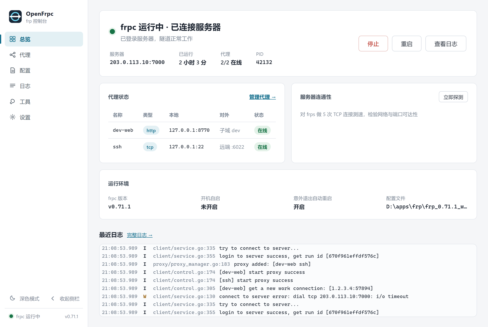
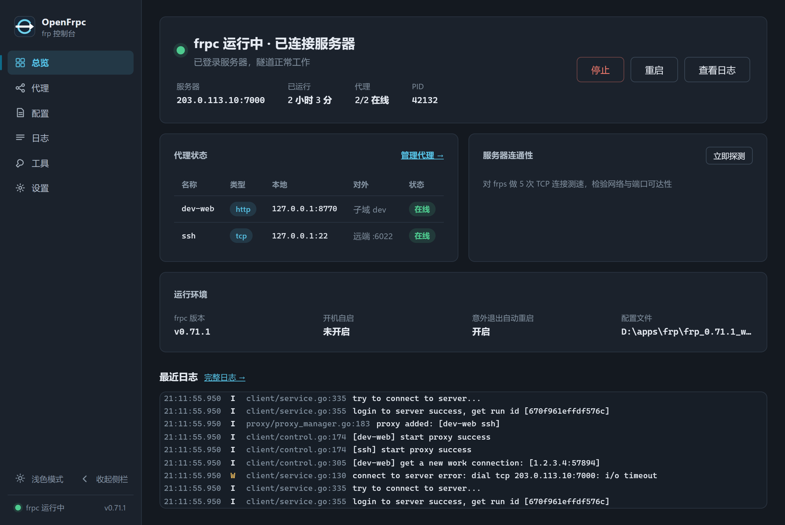
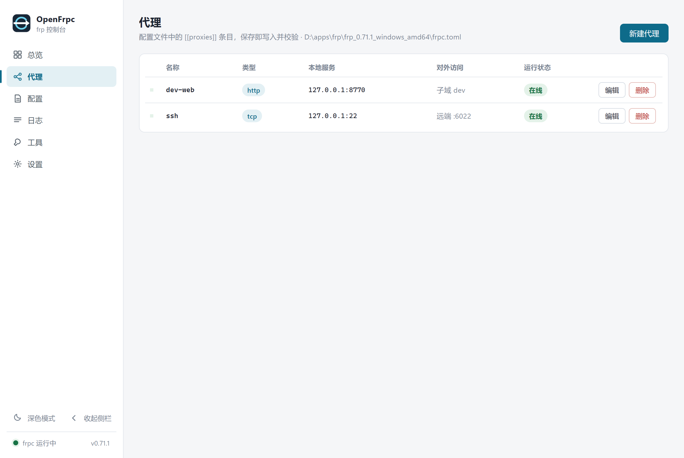
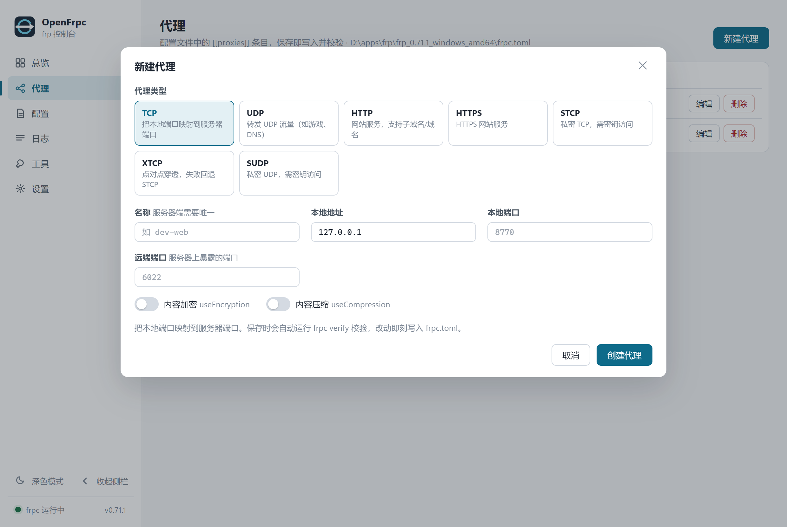
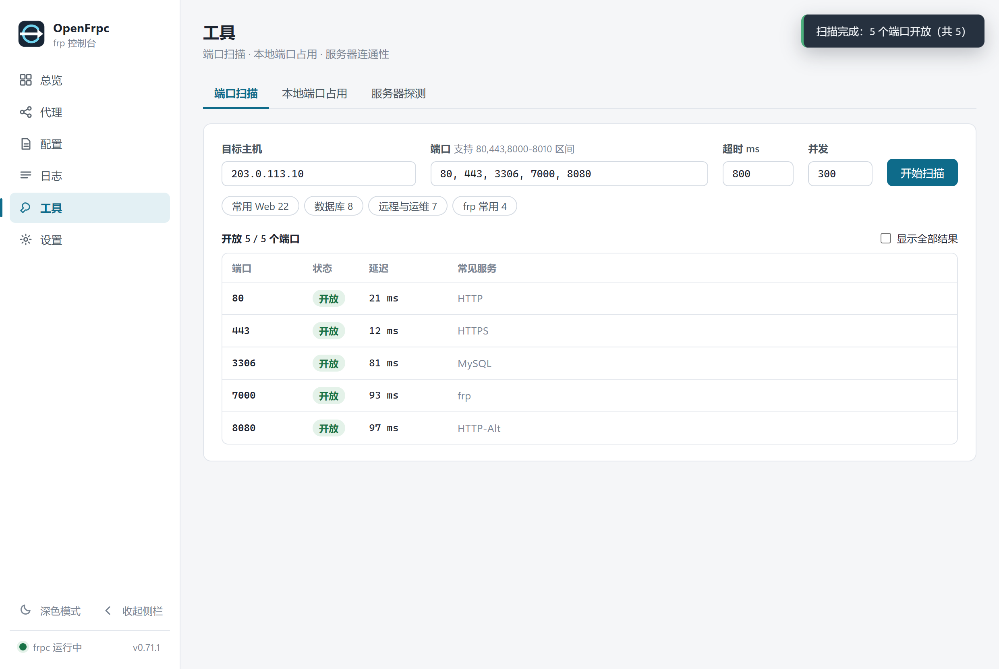
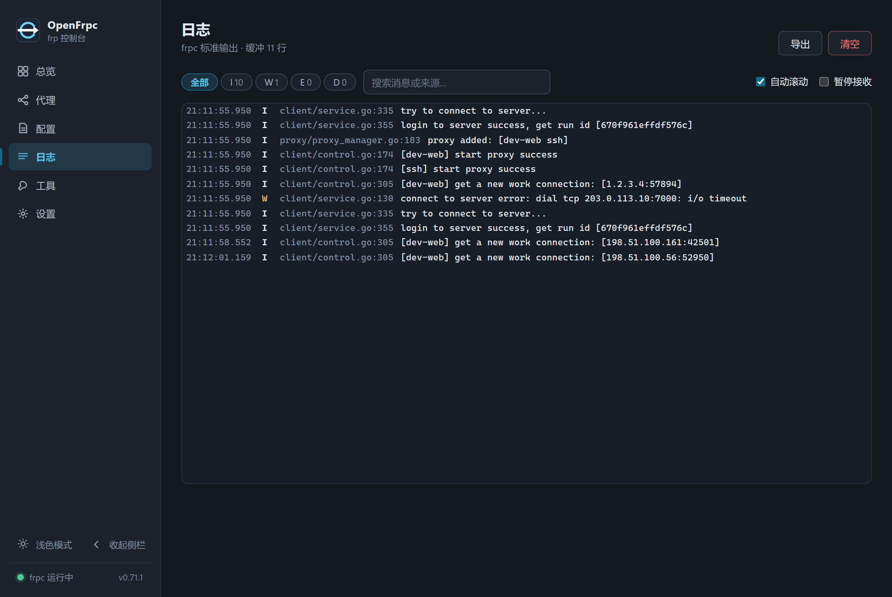

<div align="center">


# OpenFrpc

**开源的 frpc 桌面控制台** — 把命令行内网穿透客户端，变成一个看得见、点得动的桌面应用。

[](https://github.com/imicola/openfrpc/releases)
[](./LICENSE)
[](https://github.com/imicola/openfrpc/releases)
[](https://tauri.app)
[](https://vuejs.org)
[](https://www.rust-lang.org)

Tauri 2 · Vue 3 · Vite · 本地运行，不联网上报任何数据

</div>

---

<div align="center">

<table>
<tr>
<td width="50%" align="center"><b>总览 · 浅色</b></td>
<td width="50%" align="center"><b>总览 · 深色</b></td>
</tr>
<tr>
<td></td>
<td></td>
</tr>
<tr>
<td align="center"><b>代理管理</b></td>
<td align="center"><b>新建代理（全类型表单）</b></td>
</tr>
<tr>
<td></td>
<td></td>
</tr>
<tr>
<td align="center"><b>工具箱（端口扫描 / 占用查询 / 连通性探测）</b></td>
<td align="center"><b>实时日志</b></td>
</tr>
<tr>
<td></td>
<td></td>
</tr>
</table>

<sub>截图由内置演示数据（mock 层）生成，不含任何真实服务器信息。</sub>

</div>

## ✨ 功能

- **总览仪表盘** — frpc 运行状态、服务器连接健康、代理在线数、TCP 连通性测速、最近日志，一屏掌握
- **代理管理** — 可视化增删改 `[[proxies]]`，支持 `tcp / udp / http / https / stcp / xtcp / sudp` 全类型；每条代理的实时状态来自 frpc 本地管理接口
- **配置编辑** — 常用字段表单 + TOML 源码双模式；写入前自动运行 `frpc verify` 校验，并按 `frpc.toml.bak-YYYYMMDD-HHMMSS` 约定生成时间戳备份（保留 10 份），可一键恢复
- **实时日志** — frpc 输出流式捕获（自动剥离 ANSI 转义），级别过滤、搜索、冻结显示、导出
- **工具箱** — 并发端口扫描（预设 + `8000-8010` 区间语法）、本地端口占用查询（端口 → 进程名）、服务器 TCP 探测（最快/平均/最慢/成功率）
- **系统集成** — 托盘常驻、关闭最小化到托盘、开机自启、frpc 意外退出指数退避自动重启、接管外部 frpc 进程
- **深浅双主题** — 按角色分别设计的两套主题（非简单反色），跟随系统或手动切换；侧栏可收起（图标基线稳定，不打断位置感）

## 📥 安装

从 [Releases](https://github.com/imicola/openfrpc/releases) 下载最新的 `OpenFrpc_x.y.z_x64-setup.exe`（NSIS 安装包，约 1.5 MB），双击安装即可。需要 Windows 10+ 与 WebView2 运行时（安装器会自动处理）。

首次启动会自动定位 `frpc.exe` 并关联同目录的 `frpc.toml`，也可以在「设置」页手动指定。

## 🔨 从源码构建

```bash
npm install
npm run tauri dev     # 开发调试
npm run tauri build   # 产出 NSIS 安装包：src-tauri/target/release/bundle/nsis/
```

依赖：Node 20+、Rust 1.77+、Windows（其他平台理论可移植，托盘/自启动等能力未验证）。

纯浏览器预览（无 Tauri 时自动使用内置 mock 数据）：`npm run dev` 后访问 http://localhost:1420

## 🧩 实现说明

- **不碰你的配置**：启动 frpc 时若配置未启用 `webServer`，会在应用数据目录生成「你的配置 + 本地管理接口」的合并副本运行，用于轮询每条代理的实时状态；原配置文件只在编辑器保存时才被写入（且先备份）。
- **配置编辑基于 `toml_edit`**：注释与未识别字段原样保留。
- **端口扫描为普通并发 TCP connect**，仅用于自查可达性。
- 已知上游问题：frp 0.71 的 `frpc -c a.toml -c b.toml` 多配置聚合在部分 frps 下握手即断（`session shutdown`），本项目因此始终以单文件方式启动 frpc。

## 📄 许可

[MIT](./LICENSE) · 截图与演示数据均为本地演示环境，不含任何真实服务器信息。
